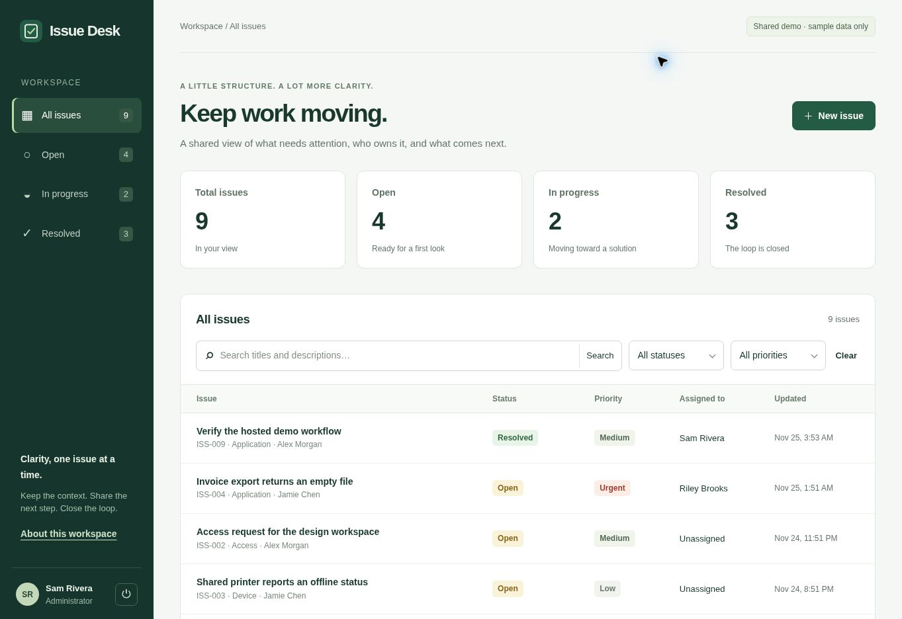

# Issue Desk

[](https://github.com/mustafaalazzawi1/issue-desk/actions/workflows/ci.yml)

A focused issue tracker: report a problem, assign responsibility, discuss the next step, and keep a history of what changed.

**Java 21 · Spring Boot · PostgreSQL · Spring Security · Flyway**

[**Try the live demo**](https://issue-desk-production.up.railway.app/) · [Recorded walkthrough](https://mustafa-al-azzawi-portfolio.mustafaalazzawi.chatgpt.site/#issue-desk-project) · [Portfolio](https://mustafa-al-azzawi-portfolio.mustafaalazzawi.chatgpt.site)

The live demo uses shared sample accounts and persistent data. Use fictional information only. Free hosting may need time to wake and can pause when its monthly allowance is exhausted.

This is an independent portfolio project by **Mustafa Al Azzawi**, developed with Codex assistance. It is not coursework. The first version demonstrates backend authorization, relational data, transactions, concurrent edits, and a complete browser workflow. The source and automated verification are published on GitHub. The live demo runs the Java application on Railway with a dedicated Neon PostgreSQL database.



## What you can do

- **Member:** create issues, search and filter your own reports, and post comments.
- **Administrator:** review every issue, assign an administrator, change priority and status, and read the activity history.
- **Everyone:** see a scoped dashboard, use a responsive keyboard-accessible interface, and resume through a normal session cookie.

Issues have four categories, four priorities, and three statuses. Status can be reopened when more work is needed. There is no deletion endpoint: reports and activity remain available in this first version.

## Run the local demo

Install **JDK 21**. Maven is downloaded by the included wrapper on the first run. On macOS, select your JDK if necessary:

```bash
export JAVA_HOME=$(/usr/libexec/java_home -v 21)
bash scripts/demo.sh
```

Open **http://localhost:8080**. The development launcher starts a real, local PostgreSQL process and stores its data in `.local/postgres`. Stop with Ctrl+C; the next launch reuses the database. It does not connect to any existing project database. Run as a normal user, not root; PostgreSQL refuses root execution. The first run needs internet access for Maven dependencies and the platform-specific database binary. Linux is the verified platform; macOS still requires a smoke test.

The local launcher is in test sources and is **not included in the production JAR**.

### Public sample accounts

| Account | Role          | Access                 |
| ------- | ------------- | ---------------------- |
| `alex`  | Member        | Alex's reports         |
| `jamie` | Member        | Jamie's reports        |
| `sam`   | Administrator | All reports and triage |
| `riley` | Administrator | All reports and triage |

All four use `IssueDesk-demo-2026!`. These are deliberately public fixtures, not private credentials. One-click demo buttons sign into Alex or Sam. Visitors share accounts and data: use fictional information only. There is no automatic reset. The sample dataset is added only when demo mode is enabled and the user table is empty.

## Run with Docker

```bash
cp .env.example .env
docker compose up --build
```

Open http://localhost:8080. The app port is bound to localhost; PostgreSQL is only exposed inside the Compose network. Database data lives in the named volume. Stop with `docker compose down`; this preserves the volume. The Dockerfile was built and deployed successfully on Railway. The local Compose workflow has not been executed in the development environment.

## Build and test

```bash
./mvnw verify
```

The integration suite sends real HTTP requests through Spring Security to a fresh **real PostgreSQL** database. It covers owner isolation, role checks, CSRF, session rotation and logout, input limits, search, pagination, assignment validation, durable comments, audit events, and two administrators saving concurrently. It uses an embedded PostgreSQL process, not an in-memory SQL substitute. Tests do not touch the local demo database.

The production artifact is `target/issue-tracker-0.1.1.jar`. The suite contains 20 HTTP/PostgreSQL integration tests and 8 request-budget tests. The workflow also runs the packaged-JAR smoke test and browser-script syntax checks. [View the latest GitHub Actions results](https://github.com/mustafaalazzawi1/issue-desk/actions/workflows/ci.yml).

## Deploy the Java app

Use a host that runs Java 21 or Docker and a **dedicated PostgreSQL database**. A static website host alone cannot run this backend. Supply:

| Variable            | Example or meaning                                                 |
| ------------------- | ------------------------------------------------------------------ |
| `DATABASE_URL`      | `jdbc:postgresql://HOST:5432/DATABASE?sslmode=verify-full`             |
| `DATABASE_USERNAME` | Dedicated database user                                            |
| `DATABASE_PASSWORD` | Database secret from the host's secret store                       |
| `PORT`              | HTTP listener, default `8080`                                      |
| `COOKIE_SECURE`     | `true` behind public HTTPS                                         |
| `DEMO_ENABLED`      | `true` for the synthetic public demonstration; defaults to `false` |

Run `java -jar target/issue-tracker-0.1.1.jar` or build the Dockerfile. Health check: `GET /api/health`. Flyway applies the versioned schema at startup. Keep database credentials out of Git. The published demo uses HTTPS, secure cookies, and a dedicated Neon PostgreSQL 17 database. Certificate and hostname verification remain enabled. See [deployment configuration](docs/DEPLOYMENT.md) for the Java trust-store setting, connection-pool configuration, and Free-plan limits. The single-replica demo has bounded application request budgets. Provider-level abuse protection, a completed backup/restore drill, and production account management remain outside this build; this is a bounded public demo, not a private help-desk service.

Demo mode is not an account-management system. With demo mode off, this version has no registration or user-provisioning UI. Do not use the public sample accounts for private reports.

## Demo traffic and maintenance

Demo mode shares three fixed one-minute budgets across all visitors: 240 API requests, including at most 12 login attempts and 30 other mutations. Exceeded budgets return HTTP 429, a short explanation, and `Retry-After` in seconds. Static pages, database health, and logout remain available. A new session or forwarded IP header does not create another budget. The policy uses constant memory, resets on restart, and is intended for one replica. It is not network-level denial-of-service protection; one visitor can temporarily use the shared allowance.

The existing reports stay intact. [Owner maintenance instructions](docs/DEMO-OPERATIONS.md) provide a read-only capacity check and a backup-first cleanup plan. No scheduled deletion or public reset control is enabled.

## Implementation notes

See [architecture and interview notes](docs/ARCHITECTURE.md), [API reference](docs/API.md), and [verification and limitations](docs/VERIFICATION.md).

The interface uses system fonts and an original SVG icon. No external analytics, CDN fonts, or third-party scripts are loaded. Dependencies retain their own licenses. This source is provided for portfolio review; no additional open-source license has been selected yet.
