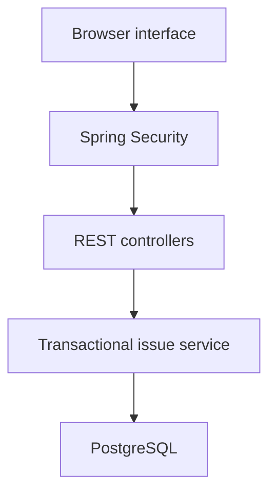

# Architecture and interview notes

## One application, one data store

Spring Boot serves both the static HTML/CSS/JavaScript and the JSON API. Same-origin requests avoid an unnecessary CORS configuration. The client renders database content with `textContent`, never HTML interpolation. Spring Security manages the session and CSRF tokens; there is no token in localStorage.

The database has users, issues, comments, and audit events. Foreign keys preserve relationships. Flyway owns schema changes. `JdbcTemplate` uses bound parameters; search wildcards are escaped so `%` and `_` are treated literally.

## Decisions worth explaining

**Authorization belongs on the server.** Each member query is scoped by the authenticated user's ID. A member requesting another member's issue receives the same 404 as a missing issue. Admin-only mutations are checked again in the service, even if a caller bypasses the UI. The client cannot choose an owner or grant a role.

**A change and its audit event are one transaction.** If saving either fails, both roll back. Comments have an author from the session, not from a client-supplied ID. The audit log is application-level history, not a cryptographically tamper-proof compliance record; database administrators can change it.

**Concurrent edits use optimistic locking.** The browser sends the version it opened. PostgreSQL updates only when that version still matches and increments the version. Two administrators saving version 0 cannot both win. The loser receives HTTP 409 and must reload. Row locks separately serialize comment-capacity checks; a database advisory lock serializes the shared issue-capacity check.

**The UI is intentionally small.** A single page provides real workflows without a second frontend build system. Native dialogs provide focus containment; tabs support arrow keys; labels, focus indicators, status messages, and narrow-screen layouts are included. This does not claim a complete accessibility conformance audit.

**Tests use the deployed shape.** HTTP requests exercise authentication, CSRF, validation, controllers, transactions, and PostgreSQL together. This catches mistakes an isolated mocked controller test would miss. A focused concurrent test proves that exactly one of two competing updates succeeds.

## Scope and next steps

The first release has no email, file attachments, registration, password reset, organizations, or SLA automation. These are deliberately deferred. Production use would need account provisioning, provider-level abuse controls beyond the shared demo request budgets, log/metric monitoring, backup restoration checks, secret rotation, and a reviewed retention policy. Public demo accounts do not provide privacy between visitors using the same account.

## Authorship

Mustafa selected this independent project for his portfolio and directed its scope and review. The implementation and tests were developed with Codex assistance. When discussing it in interviews, explain the actual decisions and code you have reviewed; do not imply that unreviewed assisted work was written independently. Use the authorization and concurrency tests as concrete examples to learn and explain.
